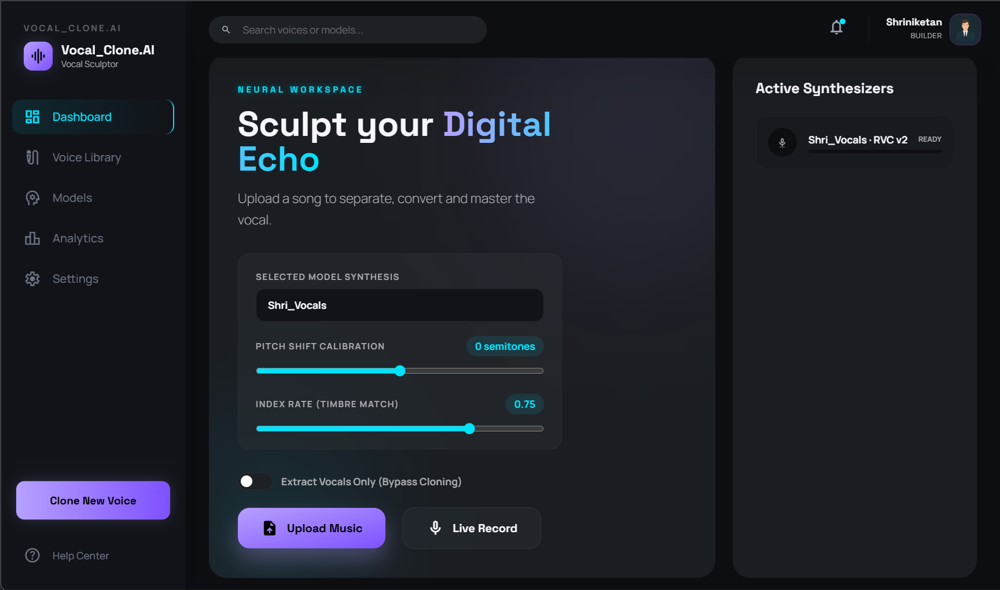
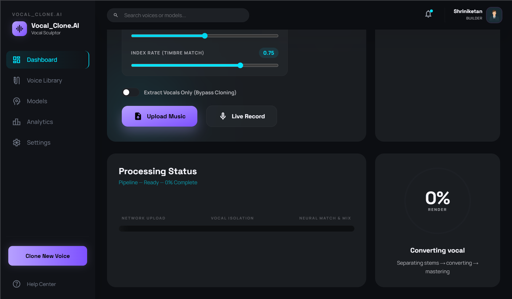

# Vocal_Clone.AI

A six-stage AI voice-conversion pipeline that re-sings a song in a target voice, keeping its pitch and expression. It's built as the hardest-case test for a bigger idea: dubbing films into other languages in the actor's own voice.

> **Showcase repo.** This repository holds the product story and screenshots only. AI coding tools wrote the code under my direction, and it isn't published here. No audio is shared, by choice, for consent and copyright reasons.
> **Full case study:** https://shriniketan-portfolio.web.app/#/case/vocal-clone-ai

## The problem

When an Indian film is dubbed into other languages, the actor's own voice is lost. I started with singing, the hardest case, because it needs pitch and expression to survive the conversion, not just words.

## What I built

A pipeline in six stages:
1. **Separate** the vocal from the music (MDX-Net).
2. **De-reverb** and clean the vocal (UVR).
3. **Track the pitch** (RMVPE).
4. **Convert** it to the target voice (RVC v2).
5. **Master** it (a 7-step Pedalboard effects rack).
6. **Remix** it with the music (FFmpeg).

A web dashboard, designed in Google Stitch, lets you pick a voice model, set the pitch shift and timbre match, and upload a song or record live.

## The key product decision: moving voice training out of the one-tap flow

The first vision was one tap: record my voice, train my model and clone a song, all on my laptop. Three things got in the way:
- **Training needs a GPU,** and my laptop has none.
- **The model learns the noise too.** Background noise in home recordings ended up in the voice, and an enhancer that removed the noise added muddy bass instead.
- **Processing was slow.** A clip under one minute took 40–45 minutes on the CPU.

So I split training out, onto Google Colab's free GPU using Applio, an open-source tool. I scoped testing to short clips and kept the app focused on conversion.

## Outcome

- Conversion worked end to end with a community voice model. My own voice model came out weak because of the noisy recordings.
- **Status: paused until better hardware.** Not every button in the dashboard works yet.

## How it was built

- **My role:** product vision, choosing the pipeline stages, scoping around the hardware limits, and testing.
- **AI and design tools:** Google Antigravity (code), Google Stitch (UI), Google Colab (training).
- **Stack:** React 19, Vite, FastAPI, Firebase, MDX-Net, RVC v2 (HuBERT + FAISS), RMVPE, Spotify Pedalboard, FFmpeg.

## Screenshots

**Workspace:** voice model, pitch shift and timbre controls.

**Processing view:** each job tracked through upload → vocal isolation → conversion and mix.

---

Built by [M I Shriniketan Joish](https://github.com/Shri0499) · [Portfolio](https://shriniketan-portfolio.web.app) · [LinkedIn](https://www.linkedin.com/in/shriniketan-joish-634599sj)
